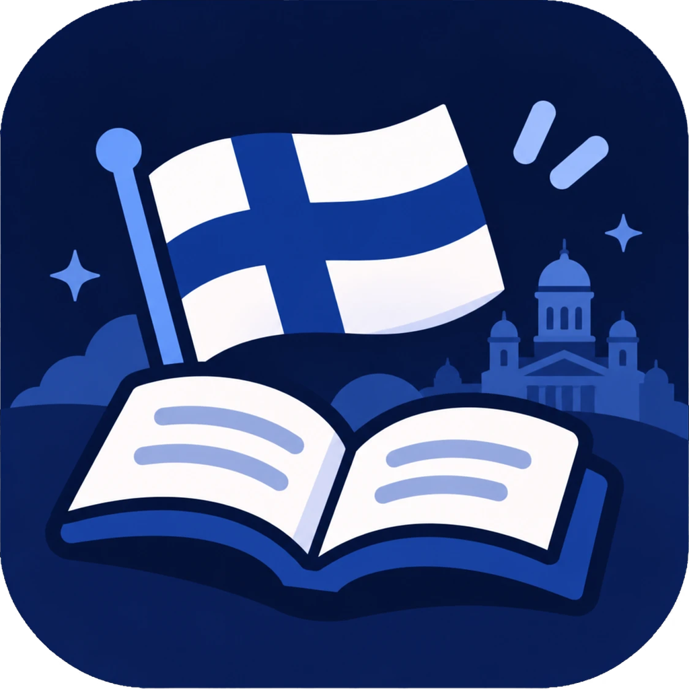
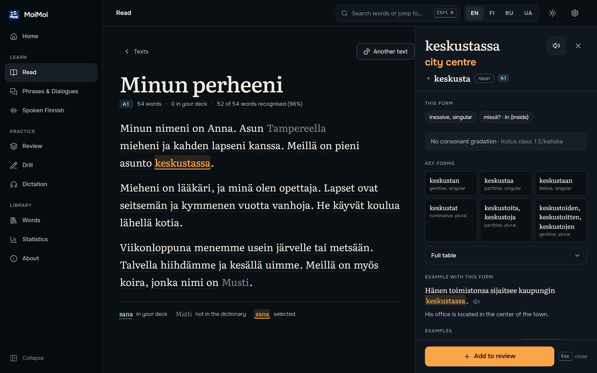
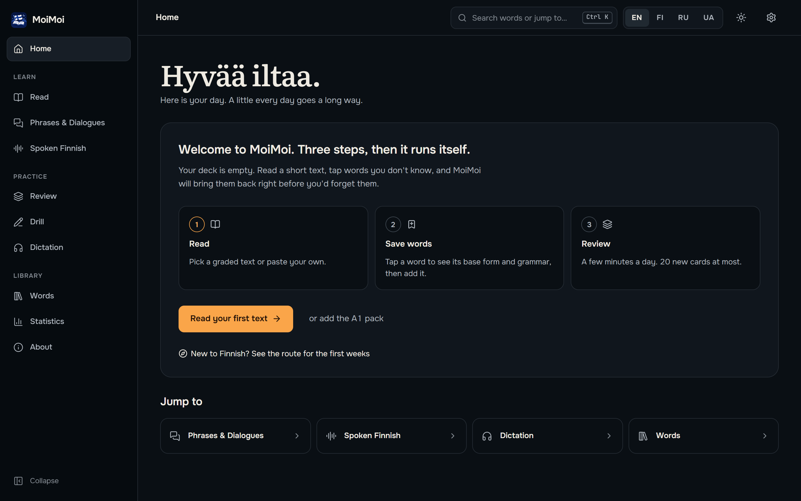
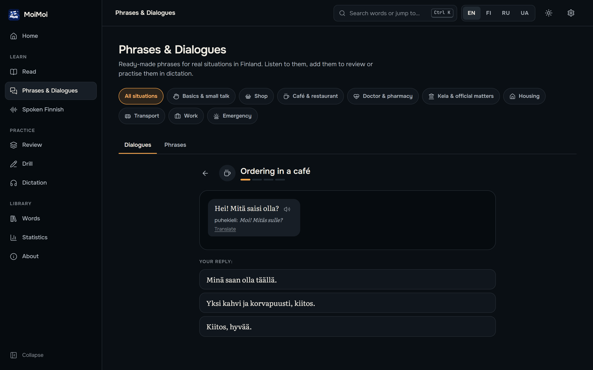
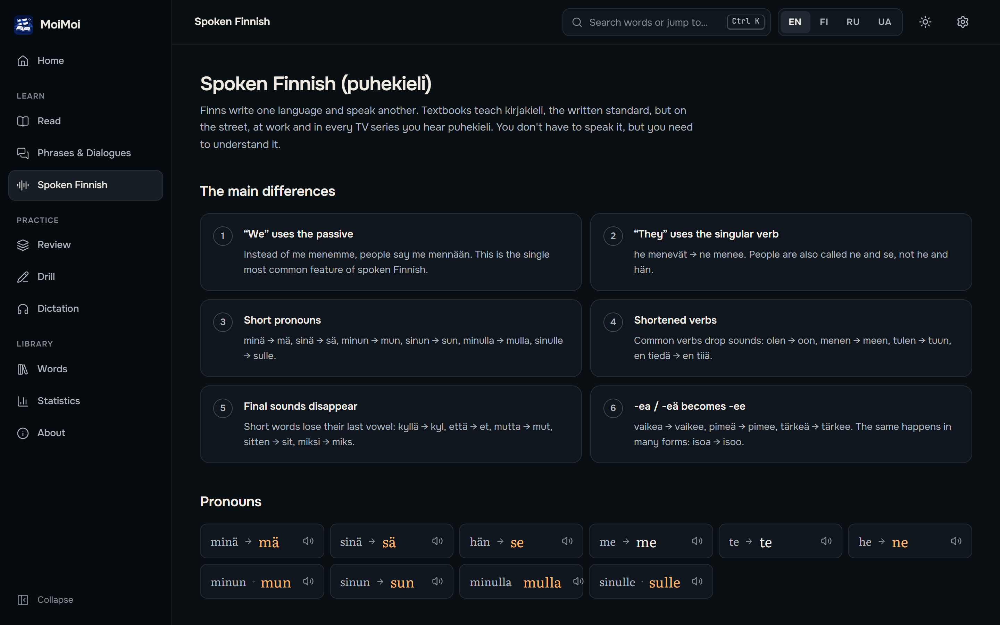
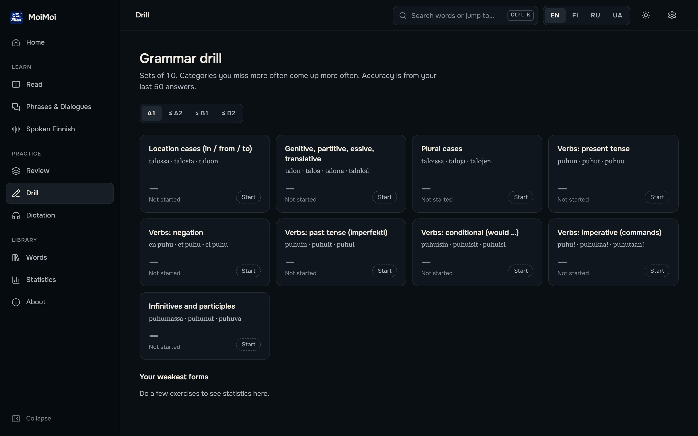
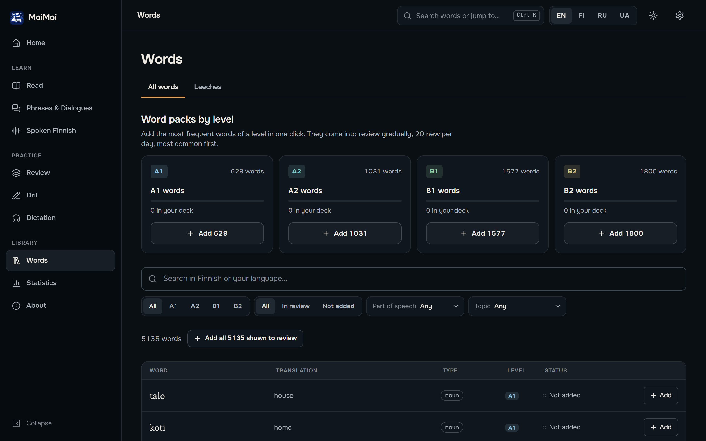
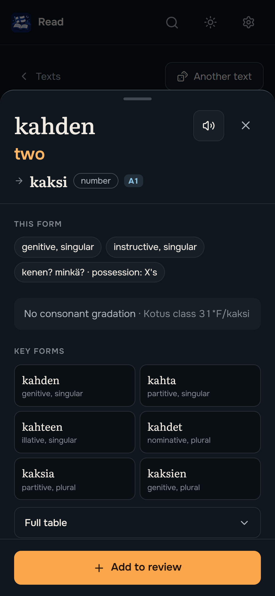

  

<h1 align="center">MoiMoi — practical Finnish</h1>

  A web app for learning Finnish the way it is actually read and spoken. 
  <a href="https://moimoi-finnish.pages.dev"><b>Open MoiMoi →</b></a>

  Interface in English · Suomi · Русский · Українська · free · works offline · no ads

## Why

Two things make Finnish hard in real life. Words in a real text are almost never in their
dictionary form (*kädessäni*, *en mennyt*, *asunnossa*), and spoken Finnish (*mä en tiiä*,
*me mennään*) is very different from the textbook language. MoiMoi is built around both problems.

## What's inside

- **Reader.** Tap any word in a text to get its base form, every grammatical reading, consonant
  gradation, key forms and the full table. Clitics, possessive suffixes, negative pairs
  (*emme menneet*) and spoken forms (*oon*, *mulla*) are recognised.
- **Dictionary of ~5,100 words (A1–B2)** with ~175,000 inflected forms and translations in
  English, Russian and Ukrainian.
- **Real example sentences** with the exact form you tapped, with translations and audio.
- **Spaced review (FSRS)** for words and phrases, both directions, typed answers with an ä/ö keyboard.
- **Grammar drill** in nine topics that adapts to your mistakes.
- **Spoken Finnish (puhekieli):** the rules and a written-vs-spoken table for any common verb.
- **Situation dialogues** (shop, café, doctor, Kela, housing, work…) where you choose the reply and
  every wrong option explains its catch.
- **Phrasebook and dictation** with natural voice recordings and a slow mode.
- **Statistics, daily goal and streak.**
- **Local-first:** progress lives in your browser; an optional account syncs it between devices.
  Installable as an app and fully usable offline.

## Screenshots

| | |
|---|---|
|  |  |
|  |  |
|  |  |

## Built with

Next.js (App Router, static export) · React · TypeScript · Tailwind CSS · Dexie (IndexedDB) ·
ts-fsrs · Supabase (optional sync, row-level security) · Service Worker / PWA · Vitest ·
Cloudflare Pages.

The dictionary, morphology tables and example index are generated by a custom data pipeline from
Wiktionary, a Finnish frequency list and Tatoeba.

## Feedback

Found a wrong translation or a bug, or have an idea?
[Open an issue](../../issues/new/choose) — any language is fine.

## Source code

The source code of MoiMoi is private. If you are an employer or a collaborator and would like to
see it, open an issue or contact me through my GitHub profile, and I'll give you access.

## Data credits

- Dictionary data: [Wiktionary](https://en.wiktionary.org) via [kaikki.org](https://kaikki.org) (CC BY-SA 4.0)
- Example sentences: [Tatoeba](https://tatoeba.org) (CC BY 2.0 FR)
- Frequency list: [FrequencyWords](https://github.com/hermitdave/FrequencyWords) (CC BY-SA 4.0)
- Voice: Google Cloud Text-to-Speech

---

© 2026 Pankalone. All rights reserved.
